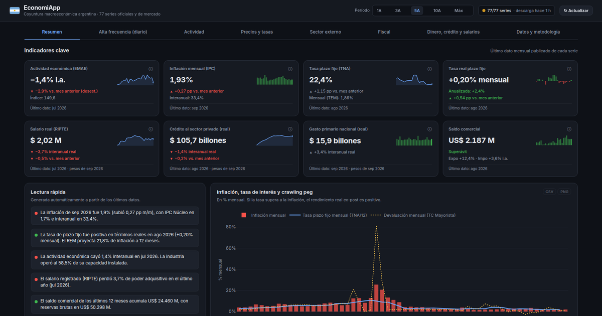

# EconomiApp

Tablero de coyuntura macroeconómica argentina: actividad, precios, tasas, sector externo, fiscal, dinero y salarios, con 77 series oficiales y de mercado.

**En línea:** https://economiapp.noya.com.ar/



Lo desarrolló Facundo Octavio Noya, Lic. en Economía.

## Qué muestra

| Sección | Contenido |
|---|---|
| Resumen | Indicadores clave, lectura automática de la coyuntura e inflación contra tasa y devaluación |
| Explorador | Hasta 4 series a elección (de ~140 mensuales y diarias), con nivel, variación mensual o interanual, suma de 12 meses o base 100, eje derecho, escala logarítmica, rango de fechas y un resumen estadístico del rango |
| Alta frecuencia | Tipos de cambio y brecha, riesgo país, reservas, tasas, UVA/CER e ITCRM diarios, y el pizarrón cambiario |
| Actividad | EMAE general y por sector, IPI, ISAC, supermercados y capacidad instalada |
| Precios y tasas | IPC por categorías, IPIM, expectativas REM, tasas pasivas y activas, y tasa real ex-post y ex-ante |
| Sector externo | Exportaciones por rubro, importaciones por uso, balanza energética, ITCRM y bilaterales |
| Fiscal | Ingresos, gasto y resultado del SPNF base caja, más la recaudación por origen, todo en términos reales |
| Dinero, crédito y salarios | Agregados monetarios, crédito y depósitos, salarios reales, desocupación y pobreza |
| Datos y metodología | Catálogo de las 77 series con filtro y orden (cada una se abre en el Explorador), estado de cada fuente, notas metodológicas y descarga de los paneles en CSV |

Cada sección tiene su propia dirección (`/#fiscal`, `/?p=10#precios`), así que se puede guardar o compartir. En el Explorador, la dirección guarda también el análisis armado (por ejemplo `/?s=Inflacion_Mensual_Pct,d.TC_Mayorista&t=ia&der=d.TC_Mayorista#explorador`). Cada gráfico se puede descargar en CSV o como imagen PNG con fondo claro para informes. Hay tema oscuro y claro, y la elección se recuerda entre visitas.

## Criterios metodológicos

- **Valores reales:** en pesos del último mes con IPC publicado: `Valor_Real[t] = Valor_Nominal[t] × IPC[T] / IPC[t]`.
- **Tasas:** `TEM = TNA/12`. La tasa real ex-post se calcula con Fisher contra la inflación observada y la ex-ante contra la mediana del REM a 12 meses.
- **Estacionalidad:** la variación contra el mes anterior se muestra solo para series desestacionalizadas. En las series originales se usa la variación interanual.
- **Transformaciones del Explorador:** en las series que ya son tasas o porcentajes, las variaciones se expresan como diferencia en puntos porcentuales. La suma de 12 meses solo se aplica a flujos mensuales. En las series diarias, la variación se calcula contra el último dato hábil hasta 7 días antes de la fecha de comparación.
- **Frecuencias:** el panel principal es mensual. Las series diarias se agregan por promedio (precios y tasas) o por último dato hábil (stocks), y además se muestran sin agregar en la sección de alta frecuencia.

## Fuentes

INDEC, BCRA (API de Estadísticas y planilla del ITCRM), Secretaría de Hacienda y Secretaría de Trabajo, a través de [apis.datos.gob.ar](https://apis.datos.gob.ar/series/api/docs/); además, Bluelytics, DolarAPI, Ámbito y Rava.

## Cómo está hecho

- **Python, Dash y Plotly.** La interfaz se arma del lado del servidor. La navegación, la exportación y algunos detalles de uso corren en el navegador (`assets/ui.js`).
- **`pipeline.py`:** descarga en paralelo desde 6 proveedores (APIs REST, planillas XLS y XLSX leídas en memoria y lectura web) y guarda una caché en Parquet. Si una fuente falla, usa el último dato guardado. Los datos ya procesados se mantienen en memoria, y una actualización manual se acepta como máximo cada 15 minutos.
- **`indicators.py`:** calcula los indicadores y la lectura automática sin depender de Dash, así que se puede testear por separado.
- **`views/`:** una vista por sección. **`ui/`:** componentes, formato es-AR (`1.234,5`), temas oscuro y claro y utilidades de gráficos.
- **`series_meta.py`:** nombre legible, unidad, grupo y tipo (nivel, flujo o tasa) de cada columna; define qué transformaciones admite cada serie.
- **`config.json`:** catálogo de series, fuentes y parámetros de la caché.
- **`tests/`:** pytest para formato, indicadores, Fisher y deflactación, caché y respaldo, y para que todas las vistas se generen.

## Correrlo localmente

```bash
python3 -m venv .venv
.venv/bin/pip install -r requirements.txt
.venv/bin/python app.py            # http://127.0.0.1:8050
.venv/bin/python -m pytest         # tests
```

Variables opcionales: `DASH_PORT`, `DASH_HOST`, `DASH_DEBUG=1`, `ECONOMIAPP_PUBLIC_URL`, `ECONOMIAPP_AUTHOR`.

En producción corre con Gunicorn detrás de nginx: `gunicorn --workers 1 --threads 8 app:server`.
